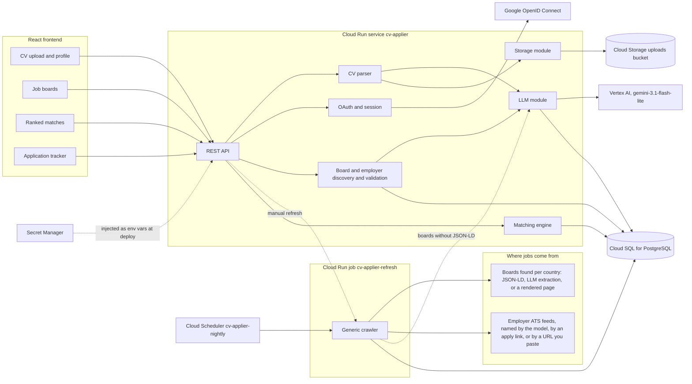
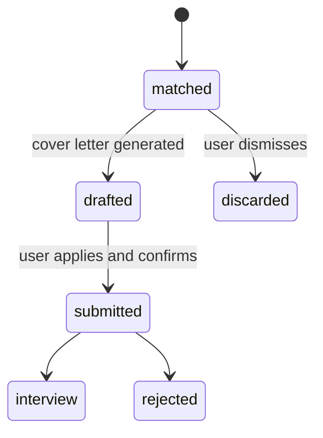
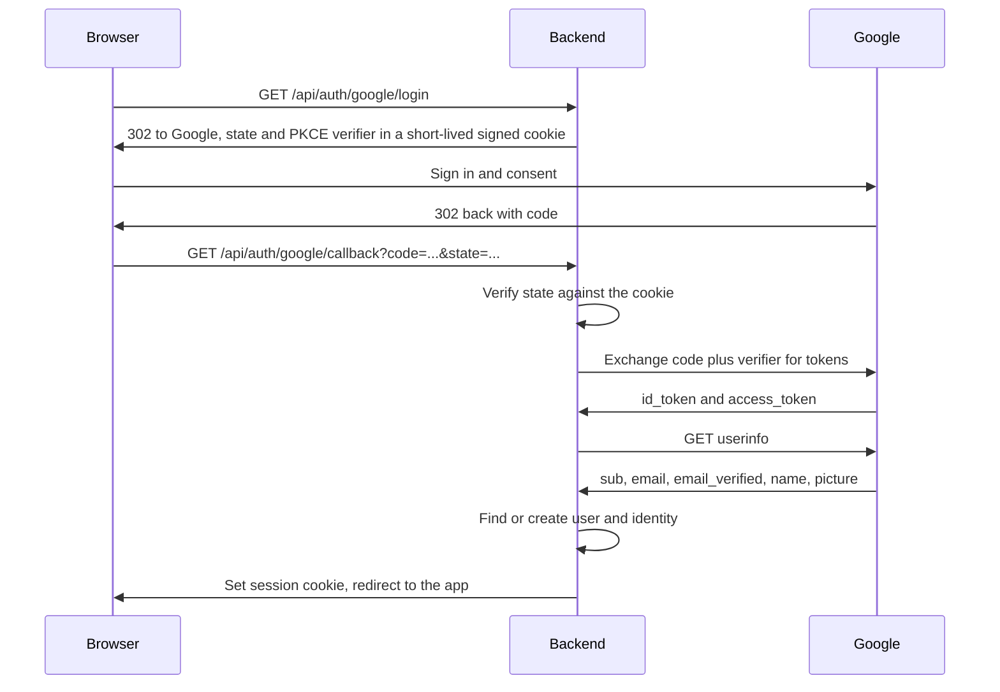

# CV Applier - v1 Plan

A web app that reads your CV, finds matching job openings in your country along with
remote roles open to you, drafts tailored cover letters, and tracks every application you
submit. It is built to
run on Google Cloud Platform, and to run locally under Docker Compose from the same
container image.

Status: through phase 5 of [BUILD.md](BUILD.md). The app runs locally under Docker
Compose on PostgreSQL, the GCP project and Terraform guardrails exist, and nothing is
deployed. [BUILD.md](BUILD.md) is the file to work from; update this plan when a phase
changes the design. See [Current state](#current-state). Live status for each phase is
tracked in [PROGRESS.md](PROGRESS.md); [LEARNING.md](LEARNING.md) is the running log of
decisions and the concepts behind them.

---

## 1. Scope

### In scope for v1

- Sign in with Google (OpenID Connect), with the provider layer shaped so GitHub or
  LinkedIn sign-in can be added later without reworking auth.
- CV upload in PDF and DOCX, parsed into a structured profile you can correct by hand,
  including the country you search in.
- Search preferences: location, remote-only, minimum salary, and a boolean keyword
  query over the title and description, such as `pandas OR r`.
- Job collection from any job board that allows crawling. Vertex AI proposes the boards
  that serve your country and the remote boards open to it, code checks every proposal,
  and one generic crawler reads them all. There is no per-site code.
- Jobs straight from the public feeds of Greenhouse, Lever, Ashby, SmartRecruiters,
  Workable, Recruitee and Workday. A company is added when the model names it, when a
  board posting already links to its feed, or when you paste that URL. One small reader
  per provider, not per company, and the feed is checked to be that company's before it
  is trusted.
- A frontend built alongside the backend, one screen per feature, so each phase can be
  checked by clicking and not only through `/docs`.
- Deterministic ranking of postings against your profile, with a readable reason per match.
- LLM-drafted cover letter per application, editable before use.
- Application tracker: matched, drafted, submitted, interview, rejected, discarded.
- Deployment on Google Cloud Platform in `europe-west3`: the backend on Cloud Run, the
  database on Cloud SQL, uploaded CVs in Cloud Storage, the LLM on Vertex AI, and a
  nightly source refresh on Cloud Scheduler. Everything is proved locally under Docker
  Compose before anything chargeable is created.
- Every one of those resources declared in Terraform and created through `terraform
  plan` and `apply`, not clicked together in the console or typed as one-off `gcloud`
  commands, so the whole cloud side can be rebuilt from a fresh checkout.

### Explicitly out of scope for v1

- Automatic submission of applications. Nothing reaches `submitted` without your click.
- Browser automation that clicks, fills forms or signs in, and any storage of third-party
  logins. A headless browser is used for one thing only: rendering pages that are empty
  until a script runs (phase 19).
- Passwords. There is no password field anywhere, so there is nothing to leak or reset.
- Paid third-party APIs, including company directories and job-data resellers. The LLM
  is Vertex AI, billed to the cloud project rather than to a key you buy yourself, so
  there is no separate vendor account to manage.
- Working around a refusal. The crawler marks a site that blocks bots or forbids crawling
  as failed and moves on, with no exceptions. LinkedIn and Indeed listings are out of
  scope, since reaching them means doing exactly that.

---

## 2. Evidence base

All of the following was verified live against the real endpoints on 2026-10-27, not
assumed. The crawler checks were made the way the real crawler will behave: `robots.txt`
honoured, one request per second per host, an identifying User-Agent, and no attempt to
get around a refusal.

### Can one generic extractor read many boards?

Twelve boards were probed: `robots.txt`, the sitemap, then two or three job detail pages.

| Board | Result |
| --- | --- |
| eJobs.ro, HiPo.ro, Remotive, RemoteOK, We Work Remotely | Works. Detail pages carry a schema.org `JobPosting` in JSON-LD |
| BestJobs.eu | Robots and sitemaps allow us, but there is no JSON-LD. The posting sits in a Next.js payload (`__NEXT_DATA__`), so it needs the LLM extraction tier |
| UndeLucram.ro | `robots.txt` allows crawlers, but its job sitemap files return 403 to an honest User-Agent |
| Jooble, Himalayas | Detail pages return 403 |
| Jobicy | Detail pages return 429 |
| LinkedIn | `www.linkedin.com/robots.txt` disallows crawlers |
| Indeed | No sitemap in `robots.txt`, `/sitemap.xml` is a 404, and search pages return 403 |

Five of twelve need no per-site code, one more needs the LLM tier, and six refuse an
honest crawler. Four things in the probe shaped the design, and each is now a rule in
section 7:

- A sitemap index names its children unhelpfully. HiPo's `sitemap_joburi.xml` lists
  search pages and `sitemap_lastjobs.xml` lists postings. BestJobs has thirteen children
  and only `sitemap.jobs.ro.xml` and `sitemap.jobs.en.xml` are postings. Picking the
  first child with "job" in its name chose wrongly for three of the first five boards, so
  the model picks from sample URLs and the code verifies the pick by extracting real postings.
- We Work Remotely's JSON-LD contains raw control characters inside strings, which a strict
  JSON parser rejects. The parser has to be lenient.
- `robots.txt` is per host. `linkedin.com` and `www.linkedin.com` serve different files and
  only `www` forbids crawlers, while `ejobs.ro`, `hipo.ro` and `bestjobs.eu` redirect to their
  `www` host. The crawler resolves the canonical host first and reads the rules there.
- Remote postings declare their audience. We Work Remotely sets `jobLocationType:
  TELECOMMUTE` and lists countries in `applicantLocationRequirements`. That is what lets
  matching drop remote roles that are not open to you.

### Can the model name the boards for a country?

One Vertex AI call (`gemini-3.1-flash-lite`, 66 tokens in, 511 out, well under a cent) asked
for the 12 most popular boards for finding work in Romania and 8 that list remote jobs open
to people living there. All 20 domains it returned are real sites. The answer is still a
list of candidates and not a source list:

- Three of the twelve "local" entries are global boards that cannot be crawled: LinkedIn,
  Indeed and Glassdoor.
- Two of the twenty did not answer when checked: `anofm.ro` failed to connect and
  `flexjobs.com` timed out.
- It returns bare domains, and the rules that matter belong to the host a redirect lands on.
- It is a model's recollection, not a registry, so it can be stale, and it may be thinner for
  a smaller market. That is why a domain can also be added by hand.

### What a JSON-LD posting looks like

Sample of the JSON-LD pulled from a live eJobs listing:

```json
{
  "title": "Area Sales Representative - Scule aschiere",
  "datePosted": "2026-09-15T11:44:26Z",
  "validThrough": "2026-10-15T00:00:00+03:00",
  "employmentType": ["FULL_TIME"],
  "hiringOrganization": { "name": "ManpowerGroup Romania" },
  "jobLocation": [{ "address": { "addressLocality": "Cluj-Napoca", "addressCountry": "RO" } }],
  "experienceRequirements": "...",
  "description": "1518 chars"
}
```

### Can employers' own job feeds be read?

Employers rarely host postings on their own site. They use an applicant-tracking system
(ATS), and most ATS products publish a public job feed so a company can show its openings
on its careers page. Greenhouse, Lever, Ashby, SmartRecruiters, Workable and Recruitee
document one. Workday has no documented feed, but its careers sites call a JSON endpoint
of their own, and that was readable. Checked earlier: Greenhouse returned 632 jobs for
Stripe and 891 for Databricks, and an Ashby board for UiPath returned 106 jobs, 21 of them
mentioning Romania.

The idea was tested on 2026-10-27 the way the plan would run it. Vertex AI named the 10
largest employers in each of Bucharest, Cluj-Napoca and Timisoara (30 companies, a few
tenths of a cent) with each one's careers page. Each careers page was fetched and searched
for ATS links, and each ATS's public feed was tried. The results:

- The model's careers URLs were reachable for 18 of 30. The rest were nine 404s, a
  connection error, a 503 and a redirect my test client did not follow.
- Only 4 careers pages showed an ATS in their raw HTML: Workday twice, SuccessFactors and
  Oracle Recruiting once each. None showed Greenhouse, Lever, Ashby, SmartRecruiters,
  Workable or Recruitee. A page that builds its links with a script shows nothing to a
  plain fetch, so this undercounts.
- Readable feeds were found for 5 of 30 companies, and 4 of them had jobs in the named
  city: Endava (SmartRecruiters, 10 of the first 100 in Cluj-Napoca), Continental
  (SmartRecruiters, 22 of the first 100 in Timisoara), Accenture (Workday, 40 jobs for a
  Timisoara search) and Flex (Workday, 1). BearingPoint's Greenhouse board had 13 jobs and
  none in Cluj-Napoca.
- A slug guessed from the company name can match the wrong company. `accenture` on
  Recruitee is a different company with 2 jobs and none in the city, so a feed must be
  verified before it is trusted.
- The largest employers by headcount are banks, telecoms, retailers and manufacturers.
  Their portals were mostly SuccessFactors, Oracle Recruiting or custom, and none of those
  was read in this test.

So about one employer in six had a feed we could read, and the feeds that worked were rich.
Employers complement the boards and do not replace them. A board gives breadth, and an
employer feed gives direct postings from the company itself, with its own apply link.

### Can an ATS be searched as one big board?

No. Each public feed is one company's board, addressed by a slug. Checked on 2026-10-27:
`https://boards-api.greenhouse.io/v1/boards` returns 404, while
`/v1/boards/stripe/jobs` on the same host returns Stripe's jobs. Lever, Ashby, Workable,
Recruitee and Workday are the same shape, one slug per request. SmartRecruiters can
narrow inside a company: `country=ro` on Endava's feed returned 81 postings, against 131
with no country filter.

A reseller that has already collected every slug sells one search across all of them.
That is a paid API, so it stays out. The way to cover more companies is to collect slugs
from links the boards already give us, which section 7 does.

### Open question to settle early

How much of a country's market the generic crawler actually reaches. In the probe about
half of the boards worked with no per-site code or with the LLM tier, and the rest refused.
Phase 9 ends by counting, for the boards discovered for your country, how many postings
each produced and by which tier, and records the table in [BUILD.md](BUILD.md). The table
decides what comes next: browser rendering in phase 19 for boards that need it, and
employer feeds in phase 20 for depth at the companies you care about. It is never a reason
to write site-specific scrapers.

---

## 3. Architecture



Stack: FastAPI, SQLAlchemy and PostgreSQL 16 on the backend; Vite, React, TypeScript and
Tailwind on the frontend. PostgreSQL everywhere, behind `DATABASE_URL`: a container
locally, Cloud SQL in production. SQLite is dropped entirely rather than kept as a second
supported engine, because a database you do not run in production is a database you do
not really test. The same container image, built from `backend/Dockerfile`, runs under
Docker Compose locally and on Cloud Run, so the artefact that passes locally is the one
that deploys.

---

## 4. Cloud design

Everything lives in one GCP project in `europe-west3` (Frankfurt), a European region
close to the Romanian market, except Vertex AI, which is called on the `global` location because
the global endpoint is the cheapest. Google's own docs now brand Vertex AI as "Gemini
Enterprise Agent Platform"; it is the same product under a new name, and this document
calls it Vertex AI throughout.

### What each service does, and why that one

| Service | What it does here | Why not the obvious alternative |
| --- | --- | --- |
| Cloud Run, service `cv-applier` | Serves the FastAPI container. `--min-instances=0`, `--max-instances=3`, `--allow-unauthenticated` because the app does its own session-cookie auth | A Compute Engine VM bills while idle and has to be patched. GKE means operating a control plane for one container. Cloud Run scales to zero |
| Cloud SQL for PostgreSQL, instance `cv-applier-db` | The database: `db-f1-micro`, 10 GB SSD, single zone, no HA | Cloud Run instances are ephemeral and can run concurrently, so a SQLite file has no shared home. Firestore would mean giving up the joins that sections 5 and 9 are built on |
| Cloud SQL connection | The built-in Cloud SQL Auth Proxy, over a unix socket at `/cloudsql/INSTANCE_CONNECTION_NAME`. The instance keeps its default address with an empty authorized-network list, so nothing on the internet can open a connection to it | Making the instance private-IP-only would need a VPC network and, on the Cloud Run side, a connector or direct VPC egress to reach it. The proxy authenticates with IAM rather than an IP allowlist, costs nothing, and gets the same result without a VPC |
| Cloud Storage, bucket `cv-applier-uploads-PROJECT_ID` | The uploaded PDFs and DOCX files. Uniform bucket-level access, not public | The container filesystem disappears with the instance. Storing the file in a database row streams large blobs through a 0.6 GB instance for no gain |
| Vertex AI, `gemini-3.1-flash-lite` | CV extraction and cover-letter drafting. See section 10 | The Gemini API in AI Studio is the same model, a different product, and the trial credit cannot pay for it. See the billing trap below |
| Secret Manager | Holds `GOOGLE_CLIENT_SECRET` and `JWT_SECRET`. Cloud Run injects them as environment variables | Passing secrets on the deploy command leaves them in shell history and in the revision config, where anyone with read access to the service can recover them |
| Artifact Registry, `europe-west3-docker.pkg.dev/PROJECT_ID/cv-applier/backend` | Holds the container image | 0.5 GB is free and a slim image is around 200 MB, so the only rule is to keep at most two tags |
| Cloud Build | Builds the image and deploys on a push to main | Building on the laptop works, but then the only machine that can ship is that laptop |
| Cloud Scheduler, job `cv-applier-nightly` | Cron `0 5 * * *`, Europe/Bucharest, triggering the `cv-applier-refresh` Cloud Run job | A source refresh walks sitemaps at one request per second for minutes. As an HTTP endpoint it would fight the request timeout and be callable by anyone; as a job it has its own timeout and no public surface |
| Cloud Logging | Structured JSON on stdout, parsed into fields | The first 50 GiB a month is free, so there is no reason to ship logs anywhere else |

### Infrastructure as code

Every resource in the table above is defined in Terraform. A config file states the
desired end state, `terraform plan` shows exactly what would change before anything does,
and `terraform apply` is the only thing allowed to touch real infrastructure. The point
is not elegance: it is that the whole cloud side can be rebuilt from a fresh checkout,
that a change is a reviewable diff before it runs, and that nothing exists which is not
written down somewhere - the opposite of a resource someone clicked into being at 11pm
and forgot about.

Two Terraform root modules, `infra/bootstrap/` and `infra/main/`, not one:

- `infra/bootstrap/` runs first, with local state, because the thing it creates is the
  bucket that will later hold everyone's state, including its own. It enables the
  handful of APIs bootstrapping itself needs, creates the
  `cv-applier-tfstate-PROJECT_ID` bucket with versioning and uniform bucket-level access,
  and creates the phase 4 budget. Once the bucket exists, bootstrap points its own
  `backend` block at it and `terraform init -migrate-state` moves its state off the
  laptop and into the bucket it just made, closing the loop.
- `infra/main/` uses that bucket from its very first `init`, under a different prefix,
  and never has permission to create or move its own backend - the state bucket is not
  something the resources it manages are allowed to touch. It holds everything else: the
  remaining APIs, the runtime service account and its roles, Cloud SQL, the uploads
  bucket, Artifact Registry, the Secret Manager containers, Cloud Run and its job, and
  the Cloud Scheduler trigger.

One thing still happens by hand, deliberately: creating the project itself and linking
billing. Terraform's provider calls Google's APIs using a quota project attached to your
credentials - the same quota project `gcloud auth application-default
set-quota-project` sets up in phase 4 - and before a project exists there is nothing to
attach it to. So the project and the billing link are two `gcloud` commands, run once,
before either module exists. Everything after that is Terraform.

Two rules keep the two modules from tangling. First, an API is enabled by exactly one
module: `storage.googleapis.com` is turned on in bootstrap because bootstrap needs it
for the state bucket, and `main` uses that same already-enabled API for the uploads
bucket without re-declaring it, so the two never fight over who owns it. Second, and
more important: a secret's *container* is a Terraform resource, a secret's *value* never
is. Terraform state is a plaintext record of everything it manages, so `main` creates the
empty `jwt-secret` and `google-client-secret` containers, and their actual values, along
with the Cloud SQL user's password, are set by hand with `gcloud secrets versions add`
and `gcloud sql users create`, exactly as before Terraform existed in this plan. Nothing
Terraform tracks is a credential.

One resource needs a deliberate carve-out: the Cloud Run service's container image.
Terraform creates the service, and phase 15's Cloud Build pipeline redeploys a new image
to it on every push, bypassing Terraform entirely. Left alone, the next unrelated
`terraform apply` - bumping `max-instances`, say - would silently roll the live image
back to whatever tag is still sitting in the `.tf` file, undoing every deploy since.
`lifecycle { ignore_changes = [template[0].containers[0].image] }` on that resource
tells Terraform the image field belongs to someone else. This is the standard shape
wherever a deploy pipeline and an infrastructure config touch the same resource:
Terraform owns the shell, the pipeline owns what is running inside it.

Not everything reaches Terraform. Connecting Cloud Build to GitHub needs GitHub's own
one-time authorization - installing a GitHub App - which has no `gcloud` or Terraform
equivalent because it is GitHub's flow, not Google's. That one click happens in the
console in phase 15; the repository reference and the trigger built on top of it are
ordinary Terraform resources.

### The local stack, and how faithfully it mirrors production

`docker-compose.yml` runs three containers: the app image from `backend/Dockerfile`, a
`postgres:16` container, and `fsouza/fake-gcs-server`. The app reaches the fake bucket by
setting `STORAGE_EMULATOR_HOST=http://gcs:4443` and otherwise uses the real
`google-cloud-storage` client. One code path, a different endpoint. That is the whole
reason to run an emulator rather than write a storage-backend abstraction with two
implementations and one real use.

| Production | Locally | How close it is |
| --- | --- | --- |
| Cloud Run | The app container under Compose | Same image, same environment variables. Cloud Run adds `PORT`, TLS termination and cold starts |
| Cloud SQL for PostgreSQL 16 | `postgres:16` container | Same engine, same SQL, same migrations. Production adds the unix-socket proxy and 0.6 GB of memory |
| Cloud Storage | `fsouza/fake-gcs-server` | Same client library and the same calls |
| Vertex AI | Vertex AI | There is no emulator, so local calls are real calls against the live API. At $0.25 per million input tokens and $1.50 per million output tokens on `gemini-3.1-flash-lite`, a development call costs a fraction of a cent, which is cheaper than building a fake |
| Secret Manager | A `.env` file read by Compose | The application sees environment variables either way and cannot tell the difference |

Phases 4 to 11 create nothing chargeable. The billing clock starts at phase 12, once the
whole backend already works locally. That ordering is deliberate: the credit is a
90-day window, and days spent debugging in the cloud are days of credit spent.

### Credentials

Application Default Credentials everywhere: `gcloud auth application-default login` on
the laptop, the attached service account on Cloud Run. The SDKs pick up whichever is
present, so no code branches on environment and no key file exists to lose.

The runtime service account is `cv-applier-run@PROJECT_ID.iam.gserviceaccount.com`, with
four roles and nothing more:

- `roles/cloudsql.client`
- `roles/aiplatform.user`
- `roles/secretmanager.secretAccessor`
- `roles/storage.objectAdmin`, granted on the uploads bucket only, not project-wide

No service-account JSON key is ever downloaded. A downloaded key is a long-lived
credential in a file, and files get committed, copied between machines and never rotated.
Application Default Credentials hand out short-lived tokens instead, and there is nothing
to leak.

### Configuration

Environment variables are the only configuration mechanism. In production Cloud Run
injects the secret ones from Secret Manager before the process starts, which is why the
application never imports a Secret Manager client: it would be a second config path for
the same values.

| Variable | Locally | On Cloud Run |
| --- | --- | --- |
| `DATABASE_URL` | `postgresql+psycopg://cv:cv@db:5432/cv_applier` | The Cloud SQL unix socket under `/cloudsql/`, set directly on the service |
| `GOOGLE_CLOUD_PROJECT` | The project id | The same project id |
| `GCS_BUCKET` | The fake bucket name | `cv-applier-uploads-PROJECT_ID` |
| `STORAGE_EMULATOR_HOST` | `http://gcs:4443` | Unset |
| `VERTEX_LOCATION` | `global` | `global` |
| `VERTEX_MODEL` | `gemini-3.1-flash-lite` | `gemini-3.1-flash-lite` |
| `COOKIE_SECURE` | `false` | `true` |

`GOOGLE_CLIENT_ID`, `GOOGLE_CLIENT_SECRET`, `GOOGLE_REDIRECT_URI`, `JWT_SECRET` and
`FRONTEND_ORIGIN` all stay as they are. `OPENAI_API_KEY`, `OPENAI_BASE_URL` and
`OPENAI_MODEL` come out in phase 7, with the `openai` package.

### Details that bite on the first deploy

- Cloud Run injects `PORT` and the container must bind `0.0.0.0:$PORT`. A container
  hardcoded to 8000 fails to start with a health-check error that never mentions ports.
- Cloud Run terminates TLS and forwards the original scheme in `X-Forwarded-Proto`.
  Uvicorn needs `--proxy-headers --forwarded-allow-ips="*"`, or the app builds the OAuth
  redirect URI as `http://` and Google rejects it.
- The session cookie needs `Secure=true` in production and `false` on `http://localhost`,
  which is what `COOKIE_SECURE` exists for.
- `db-f1-micro` has 0.6 GB of memory. That is enough for one user and a few thousand
  cached postings, and would not survive a serious workload.

### Cost

| Service | Cost to us | Why |
| --- | --- | --- |
| Cloud Run | $0 | Free tier covers 2M requests, 180k vCPU-seconds and 360k GiB-seconds a month. Scale to zero means an idle app costs nothing. |
| Cloud SQL `db-f1-micro` + 10 GB SSD | about $10 a month | $0.0105 an hour for the instance plus about $1.70 a month for storage. No free tier. This is the only meaningful running cost. |
| Cloud Storage | under $0.10 a month | The 5 GB free tier is US-only, so `europe-west3` bills from the first byte at about $0.02 per GB-month. |
| Terraform state bucket | under $0.01 a month | A handful of small JSON files in `europe-west3`, billed the same as the uploads bucket. |
| Vertex AI, `gemini-3.1-flash-lite` | about $0.005 per cover letter | $0.25 per million input tokens, $1.50 per million output tokens. |
| Vertex AI, board and employer discovery and extraction | under $0.001 per discovery call, about $0.001 per board validated, about $0.001 per page on a board that needs the LLM tier | Same prices. The one cost that grows with the number of boards: a board on the LLM tier at its cap of 30 pages a run is at most about $0.04 a night, so about $1 a month. Boards with JSON-LD cost nothing. |
| Artifact Registry | $0 | 0.5 GB free. A slim image is around 200 MB, so keep at most two tags. |
| Secret Manager | $0 | 6 active secret versions and 10,000 access operations free per month. |
| Cloud Build | $0 | 2,500 build-minutes free per month. |
| Cloud Scheduler | $0 | 3 jobs free per month. |
| Cloud Logging | $0 | First 50 GiB per project per month. |

Total is roughly $12 a month, so about $36 across the 90-day credit window, leaving the
large majority of the $300 unspent. A few boards on the LLM tier add a few dollars at most.

The credit terms matter as much as the figures. The $300 is valid for 90 days from the
creation of the billing account, and unused credit expires, so the deadline is a calendar
one and not a spending one. When the credit runs out the trial billing account auto-closes
rather than charging the card. A $50 budget with alerts at 50%, 90% and 100% is created on
the billing account in phase 4, before any resource exists, because a budget added later
is a budget added after the mistake. The trial also blocks GPUs and TPUs, Cloud
Marketplace, quota-increase requests, Windows Server VMs and managed third-party
generative-AI models, limits Compute Engine to eight concurrent cores, and comes with no
SLAs or support. None of that constrains this app.

### The billing trap

The credit cannot pay for the Gemini API in Google AI Studio. It can pay for Vertex AI.
They serve the same models and are two different products with two different billing
paths, and picking the wrong one means a card charge next to $300 of unspent credit. Every
model call in this project goes through Vertex AI. This is the single most important
gotcha in the integration, which is why it appears here, in section 10, and in
`docs/llm.md`.

---

## 5. Data model

Defined in [backend/app/models.py](backend/app/models.py).

- `users` - identity-independent account: email, display name, avatar URL, timestamps.
  No password column.
- `identities` - one row per external login linked to a user: `provider`, `subject`
  (the provider's stable user id), unique on `(provider, subject)`. This is what lets
  GitHub or LinkedIn sign-in be added later without touching `users`.
- `profiles` - one row per user, holding both the CV-derived fields (titles, skills,
  years of experience, summary, and `country` and `city` as read from the CV, the country
  as an ISO 3166-1 alpha-2 code) and the search preferences (preferred locations,
  remote-only, minimum salary per month with its `salary_currency`, a boolean
  `keyword_query`, hidden companies). One table because there is exactly one of each per
  user. `country`, `city` and `salary_currency` arrive in phase 7, `keyword_query` and
  `hidden_companies` in phase 10.
- `job_sources` - one row per job board or employer: its canonical host, `kind` (`local`,
  `remote` or `employer`), the country it was discovered for (empty for remote boards),
  `status` (`candidate`, `active`, `disabled` or `failed`) with a plain-text reason, the
  extraction tier (`jsonld`, `llm` or `ats`), for an employer its ATS provider and
  identifiers (a slug, or a tenant and site for Workday), whether it needs a browser to
  render (phase 19), the posting sitemaps and URL prefix chosen at validation, and when it
  was last checked and refreshed. Shared rather than per user, like `jobs`: v1 has one
  user, and two users in the same country would want the same boards. Arrives in phase 8;
  `needs_render` arrives in phase 19 and the ATS columns in phase 20.
- `jobs` - shared cache of postings, unique on `(source, external_id)`, so two users
  searching the same day do not trigger a refetch. `source` is the board's host and
  `external_id` is the posting's normalised URL, which is the one identifier every board
  has. Phase 8 widens both columns and adds `expires_at`, which the "not expired" filter in
  section 9 needs, `eligible_countries`, the countries a remote posting is open to,
  `salary_min`, `salary_max` and `salary_currency`, and two columns for duplicates:
  `fingerprint`, a hash of the normalised company, title and city, and `first_seen_at`,
  set on insert and never updated. The same job on two boards, or reposted under a new
  URL, shares a fingerprint, and matching shows it once.
- `applications` - the join between a user and a job. This is where the review queue lives,
  carrying status, score, match reason, cover letter, notes and timestamps.

Apart from those additions the tables are as first designed. What changed underneath them
is that the database is PostgreSQL 16, and Alembic owns the schema. That supersedes the earlier decision to call
`Base.metadata.create_all` on startup and delete the database file whenever the schema
moved.

Two things forced it, and neither existed before the cloud decision. The data now lives in
a managed database that cannot casually be deleted, so "drop it and restart" stops being a
development convenience and becomes data loss. And more than one Cloud Run instance can
cold-start at the same time, so `create_all` becomes a race: two processes issuing the same
DDL against the same database, with the loser erroring on startup. Alembic was adopted
in phase 5, before anything is deployed, and the first migration was written against the
local Postgres container.

### Application lifecycle



The transition to `submitted` is only ever triggered by an explicit user action. This is
the core design commitment of the product.

---

## 6. Authentication

Google sign-in over OpenID Connect, using the authorization code flow with PKCE. The
endpoints below come from Google's live discovery document, checked today:

- Authorization: `https://accounts.google.com/o/oauth2/v2/auth`
- Token: `https://oauth2.googleapis.com/token`
- Userinfo: `https://openidconnect.googleapis.com/v1/userinfo`
- Scopes: `openid email profile`, and `code_challenge_method=S256` is supported



Design notes:

- No Google tokens are stored. We need Google only to establish who you are at login;
  afterwards the app runs on its own session cookie, so there is nothing long-lived to
  protect or refresh.
- The session is our own JWT in an httpOnly, SameSite=Lax cookie, signed with `JWT_SECRET`.
  `Secure` comes from `COOKIE_SECURE`: off on `http://localhost`, on in production.
- `state` and the PKCE verifier live in a short-lived signed cookie rather than a
  server-side session store, which keeps the backend stateless. That matters more now:
  Cloud Run can serve two consecutive requests from two different instances.
- Provider extensibility is a dict of provider configs plus a claim-mapping function, so
  adding GitHub is a new entry and a small mapper, not a new auth system.
- Account linking: if a login arrives for an email that already exists, we attach a new
  identity row to that user, but only when the provider reports the email as verified.
  Linking on an unverified email is an account-takeover path.
- Dependency effect: `bcrypt` comes out of the requirements, and nothing new goes in;
  `httpx` and `pyjwt` are already there.

Local setup needed from you: a Google Cloud OAuth client (Web application) with redirect
URI `http://localhost:8000/api/auth/google/callback`, providing `GOOGLE_CLIENT_ID` and
`GOOGLE_CLIENT_SECRET`. Phase 13 adds the Cloud Run URL to the same client as a second
authorized redirect URI, so one client serves both environments.

One clarification, since the names collide: LinkedIn sign-in is OpenID Connect and is
perfectly allowed. It has nothing to do with LinkedIn's jobs API, and adding it would not
give us access to a single job posting.

---

## 7. Job sources

There is no code per job board. One generic crawler reads any board that publishes a
sitemap and either structured data or readable pages, and the list of boards is data in
the `job_sources` table, not files in the repository. Adding a board means adding a row.
Employers are the one place with per-provider code, a small reader for each ATS product
and never one per company, because the variation there is between a handful of feed
formats and not between sites.

```python
@dataclass
class Posting:
    source: str                    # the board's canonical host
    external_id: str               # the posting's normalised URL
    url: str
    apply_url: str
    title: str
    company: str
    locations: list[str]
    remote: bool
    eligible_countries: list[str]  # ISO alpha-2; empty means unrestricted or unknown
    employment_type: str
    description: str               # plain text, never HTML
    salary_min: int | None         # per month, in salary_currency
    salary_max: int | None
    salary_currency: str           # ISO 4217; empty when the posting states no salary
    posted_at: datetime | None
    expires_at: datetime | None
```

There is no `JobSource` protocol any more. It existed to give several hand-written
adapters one shape. With one crawler there is one implementation, and the coding rules
forbid an interface with a single use.

### Finding boards

`POST /api/sources/discover` with `kind=boards` sends one Vertex AI prompt for the country
on the profile. It asks for the most popular boards people use to find work there, and for the boards that
list remote jobs open to people living there, as JSON objects of `{domain, kind}`. Each
domain not already known is stored as a `candidate`. The answer is never trusted: a
candidate becomes `active` only by passing validation, and you can add a domain by hand
(`POST /api/sources`) or switch any source off.

The country comes from the profile and not from sign-in. Google's `openid email profile`
claims carry no location, and the `locale` claim is a language. The CV extraction reads the
country and the city from the address on the CV and the Profile screen lets you correct
both. Board discovery refuses to run until a country is set, and employer discovery until a
city is.

### Validating a board

Validation runs at the start of a candidate's first refresh and costs a handful of requests
and one model call.

1. Fetch `/robots.txt`, following redirects. The host it lands on becomes the canonical
   domain. Stop if the rules disallow crawlers.
2. Read the `Sitemap:` lines, falling back to `/sitemap.xml`. No sitemap means `failed`.
   Expand one level of sitemap index and take a few sample URLs from each child.
3. Ask Vertex AI which child sitemaps hold individual job postings, as opposed to search,
   city, category, employer or article pages, and which URL path prefix the postings share.
   The model chooses from the samples it is shown.
4. Fetch three postings from the chosen set and run extraction. Two of the three must yield
   a title and a description. The tier that worked is recorded: `jsonld`, otherwise `llm`.
5. Any other outcome ends in `failed` with the reason in plain words: `disallowed by
   robots.txt`, `no sitemap`, `blocked (403)`, `no postings found`, `needs a browser`.

The model picks and the code verifies. That split is the point: the probe in section 2 shows
a model's recollection of boards and of sitemap structure is mostly right and sometimes
wrong, and a wrong pick that is checked costs three requests.

### Reading postings

Tier 1, `jsonld`, is free and deterministic. Find the `JobPosting` node in the page's
JSON-LD, including inside `@graph`, parsed leniently. Map `title`, `description`,
`employmentType`, `hiringOrganization.name`, `jobLocation[].address`, `jobLocationType`,
`applicantLocationRequirements`, `baseSalary`, `datePosted` and `validThrough`. Country
names are normalised to ISO alpha-2 codes. A salary is converted to a monthly figure from
its `unitText` (year, month, week, day or hour) and left empty when the posting gives none,
which on many boards it does not.

Tier 2, `llm`, is for boards with no structured data, such as BestJobs. Reduce the page to
its visible text plus any embedded JSON payload, truncate it, and ask Vertex AI for the same
fields, with `null` as the answer when the page is not a single posting. It costs about a
tenth of a cent a page, so it has a lower cap than tier 1.

Remote detection: `jobLocationType: TELECOMMUTE` first, then a short list of remote
keywords in English and Romanian ("remote", "de acasa", "telemunca", "hibrid") on
diacritic-normalised text.

### Refreshing a board

`POST /api/sources/{id}/refresh` validates a `candidate`, then crawls an `active` source:
read its posting sitemaps, order by `lastmod` newest first (document order when there is
none), drop URLs already in `jobs`, take up to the cap, fetch, extract, and upsert on
`(source, external_id)`. The caps are 100 pages per run for tier 1 and 30 for tier 2.

Each upsert also computes the posting's fingerprint, a hash of the normalised company,
title and city, and sets `first_seen_at` on insert only. Normalisation is one shared
function: lowercase, strip diacritics and punctuation, drop legal suffixes such as `SRL`,
`SA`, `Ltd` and `GmbH`. The fingerprint is how a job listed on three boards, or reposted
under a new URL every few weeks, is recognised as one job.

One source per request keeps every request bounded, and the Sources screen refreshes boards
one after another. The `cv-applier-refresh` Cloud Run job loops the same function over every
active source each night. Boards are crawled one at a time, so ten boards at the cap take
about seventeen minutes against the job's 30 minute timeout; crawling different hosts
concurrently is the first optimisation if that stops being enough. A long run is why the
nightly refresh is a job and not an endpoint.

A `failed` source is skipped by the nightly job. Refreshing it by hand validates it again.

### Rules the crawler never breaks

- Politeness: one request per second per host, longer when `robots.txt` asks, an
  identifying User-Agent, and a hard page cap per run.
- `robots.txt` is read on the host that serves the page, and every URL is checked against it.
- A 403 or 429 marks the source `failed`. There is no retry with another User-Agent, no
  proxy and no headless browser. A board that refuses an honest crawler is a board we do
  not have.
- `https` only. Before every request, including each redirect hop, the host is resolved and
  refused if any address is private, loopback, link-local or otherwise reserved. This stops
  an unchecked domain, whether from the model or typed in, from aiming the crawler at Cloud
  Run's metadata server, which hands out the runtime service account's token. DNS
  rebinding is out of scope for a single-user tool.
- URLs read from a sitemap, and redirect targets, are fetched only if they are on the
  source's own host or its `www.` counterpart. Each redirect hop is checked against the
  address guard and the `robots.txt` of the host it lands on, before it is followed.
- Every response has a size limit, 5 MB for a page and 20 MB for a sitemap, so a hostile
  server cannot exhaust memory.
- Descriptions are stored as plain text and rendered as text, never as HTML. They are
  third-party content, and rendering them as HTML would be stored XSS.
- Page text sent to the model is untrusted input. The model has no tools, its output is
  parsed into fixed, length-capped fields, and every cover letter is reviewed by you
  before anything is sent.
- A page that only renders in a browser comes back empty to a plain fetch and is `failed`
  with `needs a browser` until phase 19 adds rendering. Rendering changes how a page is
  fetched and nothing else: the browser obeys `robots.txt`, sends the same honest
  User-Agent, and a 403 is still a 403.

A `robots.txt` that allows a crawler is not a licence to republish. This is personal-scale
use: descriptions are stored to rank and to draft letters, and are not shown to anyone else.

### Rendering JavaScript-heavy boards (phase 19)

Some boards send an empty page and build the listings with a script. For those, validation
retries through Playwright and records `needs_render` on the source when that makes tier 1
or tier 2 work. Chromium is launched headless with the same User-Agent. Every request the
browser makes passes through the same address guard, through Playwright's request-routing
hook, and images, fonts and media are blocked. There are no stealth plugins and no proxies.
A browser run takes seconds a page, so its cap is lower than the plain one. The browser
executes untrusted JavaScript and adds hundreds of megabytes to the image, so where it runs
is decided in that phase from measured size and memory, not assumed here.

### Employers and their ATS feeds (phase 20)

A board gives breadth. An employer's applicant-tracking system gives depth: the JSON feed
its own careers page already uses, with the company's apply link. There is no HTML crawl
of the careers page and no separate "is this a job description" classifier, because a row
in that feed is a job. The numbers behind the coverage are in section 2.

A company lands on the list in one of three ways:

1. **Named.** `POST /api/sources/discover` with `kind=employers` asks Vertex AI for the
   largest employers in the profile's city that hire for the profile's titles, as
   `{company, website}`. The model gives a name and a domain and not a careers URL, because
   only 18 of the 30 careers URLs it gave in the test were reachable. Each company is stored
   as a `candidate` with `kind = employer`.
2. **Linked.** When a board posting's `apply_url` is already on a known ATS host, the slug
   is parsed out of that URL and stored as an employer candidate. The board crawl does not
   fetch the link. One listing on eJobs is enough to subscribe to that company's whole feed,
   including jobs that never appeared on the board. The hosts are `boards.greenhouse.io`
   and `job-boards.greenhouse.io`, `jobs.lever.co`, `jobs.ashbyhq.com`,
   `apply.workable.com`, `jobs.smartrecruiters.com` and `careers.smartrecruiters.com`,
   `{slug}.recruitee.com`, and `{tenant}.{cluster}.myworkdayjobs.com`.
3. **Pasted.** `POST /api/sources` accepts one of those URLs as well as a bare domain. An
   ATS URL skips the career-page search.

Validation, at the first refresh:

1. For a named company with no slug yet, fetch the home page and the usual careers paths
   (`/careers`, `/jobs`, `/cariere`), plus any link whose text or address says career or
   job. A page that is only a script shell is rendered through phase 19, if that phase
   exists. Take the ATS identifiers from those links. If none is found, try the providers'
   public feeds with slugs derived from the company name. A linked or pasted source
   already has its identifiers and skips this step.
2. Verify that the feed belongs to the company. A feed that gives its company name must
   match. A feed that does not must contain at least one job in the candidate's country.
   In the test `accenture` on Recruitee was a different company, and this is the rule that
   rejects it.
3. Ask Vertex AI once whether the company is a direct employer or a staffing agency, from
   its name and the short description on the feed. An agency is stored `disabled` with the
   reason `staffing agency`. Switching it on is the same control as any other source. The
   call is once per company. If it fails, the source stays a candidate and the reason says
   the check did not run.
4. Anything else is `failed` with a plain reason such as `no supported ATS found`.

Reading: one small mapping per provider, not per company, from its feed to a `Posting`,
with the employer's own apply link and descriptions as plain text. Salary, remote and
employment type are taken from the feed when it has them. Phase 20 adds
`jobs.experience_level`, filled from the feed when the feed has one, and matching then
uses it in place of a level word in the title. Greenhouse, Lever, Ashby, Workable and
Recruitee document a public job feed and include the description in the list call.
SmartRecruiters documents one too, and its list call accepts `country` and `city`, so a
refresh asks for the profile's country and only then fetches a description, one request
per new posting, inside the cap. Workday has no documented feed: its careers sites call
`POST /wday/cxs/{tenant}/{site}/jobs`, which is undocumented and can change. A refresh
takes up to 100 new postings, newest first, like any board. Jobs outside the profile's
country are dropped before a detail request.

The crawler's rules apply unchanged: one request per second per host, `robots.txt` checked,
the address guard, no proxies and no retry after a block. These are the feeds each careers
page uses itself. Each provider's terms are checked when its reader is written. Every
Greenhouse company shares the host `boards-api.greenhouse.io`, so they wait on each other.
The nightly job reads employer feeds after boards and stops that portion after 15 minutes,
resuming the next night at the sources least recently checked. In matching, a job found
both on a board and on its employer's feed shows the employer's posting and its direct
apply link.

Not covered: SuccessFactors, Oracle Recruiting, Taleo, iCIMS and custom portals, which is
where the banks, telecoms and retailers in the test were. More providers are added when the
coverage table asks for them. A crawl of every careers page on the internet, a rotating
proxy, and a refresh several times a day are not how this stays inside those rules. One
nightly pass of the feeds above is the refresh.

---

## 8. CV parsing and profile

The upload endpoint writes the file to the Cloud Storage bucket first, under a per-user
key, through `backend/app/storage.py`. Locally that is `fake-gcs-server` and in production
the real bucket, with the same client either way. Keeping the original costs a fraction of
a cent a month and means a later parser fix can be re-run over what you actually uploaded
instead of asking you to upload it again.

`pdfplumber` for PDF and `python-docx` for DOCX then produce plain text into
`profiles.cv_text`. That text goes through one Vertex AI call returning structured JSON:
name, headline, titles, skills, years of experience, summary, country and city. The country
is an ISO alpha-2 code and both come from the address on the CV, empty when there is none.
The country decides which boards discovery asks about and the city which employers
(section 7).

The parsed profile is fully editable in the UI. LLM extraction will get things wrong, and
the fix is letting you correct it rather than engineering around it.

---

## 9. Matching

Deterministic scoring with no LLM cost per posting, so a run over thousands of jobs is
free and instant.

1. Hard filters: location must intersect your preferred locations, or the job must be
   remote and open to your country (`eligible_countries` empty or containing it), and the
   posting must not be expired. The company must not be one you have hidden. When the
   posting states a salary in your `salary_currency`, its top figure must reach your
   minimum. A posting with no salary, or in another currency, passes, because there is no
   exchange-rate source here and most postings state none: the filter removes only what is
   known to be too low. The boolean `keyword_query` is applied here too, on the normalised
   title and description. The language is words, quoted phrases, `AND`, `OR`, `NOT` and
   parentheses, and two adjacent words mean `AND`. A one-letter word such as `R` matches
   only as its own word. An empty query filters nothing.
2. Collapse duplicates. Postings with the same fingerprint become one match. Then, within
   one normalised company, a description whose word overlap with an older posting is high
   joins that group too, which is how a repost with a rewritten title is caught. The
   overlap threshold is chosen in phase 10 from real pairs and written into
   `docs/matching.md`. The match shows the live posting, preferring the employer's own
   feed over a board so the apply link goes straight to the company, lists the other
   places it appears, and counts how many times it was reposted under a new URL.
3. Score from 0 to 100: title overlap against your known titles, skills overlap against
   the description, and a recency boost. Recency, and the "newer than" filter, count from
   the earliest of the group's `posted_at` and `first_seen_at`, so a repost does not look
   new. A board can refresh `datePosted` on a repost while our own first sighting cannot
   move. A seniority check compares a level read from the title (intern or "stagiar",
   junior, senior, lead) with your years of experience and takes points off a mismatch of
   two levels or more. A title with no level word gives no signal and no penalty. From
   phase 20, a feed's own `experience_level` wins over the title word when it is set.
4. Every match stores a readable reason, for example "matches 7 of your skills: Python,
   FastAPI, Docker...", with the age and reposts appended when they matter, such as "first
   seen 40 days ago, reposted 3 times", so the ranking is never a black box.

Text is normalised for Romanian diacritics, and a small synonym map handles the bilingual
reality of the market, where the same role is posted as "Dezvoltator" or "Developer". The
map is Romanian and English only. For any other country matching still works on
normalised overlap, just without synonyms, until a map for that language is added.

---

## 10. LLM module

One module, `llm.py`, holds every prompt: `extract_profile(cv_text)`,
`propose_job_boards(country)`, `propose_employers(city, country, titles)`,
`pick_posting_sitemaps(samples)`, `extract_posting(page_text)`,
`classify_employer(name, blurb)` and `draft_cover_letter(profile, job)`.
`classify_employer` arrives in phase 20 and is one call per company. All call Vertex AI
through the `google-genai` SDK:

```python
from google import genai

client = genai.Client(
    vertexai=True,
    project=settings.google_cloud_project,
    location=settings.vertex_location,   # global
)
response = client.models.generate_content(
    model=settings.vertex_model,         # gemini-3.1-flash-lite
    contents=prompt,
)
```

The model is `gemini-3.1-flash-lite`. It was released on 2026-05-07 and is supported until
at least 2027-05-07, so it comfortably outlives the credit window, and at $0.25 per million
input tokens and $1.50 per million output tokens a cover letter costs about half a cent.
The location is `global` because non-global endpoints cost 10% more for the same model.

Vertex AI rather than the Gemini API in AI Studio, for two reasons. The trial credit pays
for Vertex AI and cannot pay for AI Studio, which would turn a free project into a card
charge. And Vertex AI authenticates with the same Application Default Credentials as Cloud
SQL and Cloud Storage, so there is no API key in this project at all.

That also removes a design that used to be here. There is no provider abstraction and no
OpenAI-compatible base URL, because there is one model behind one SDK, and `openai` comes
out of the requirements in phase 7. There is no keyless fallback either: credentials come from the
cloud project rather than from a key you may or may not have pasted into `.env`, so a
degraded keyword-matching path would be dead code guarding a case that cannot happen. If
Vertex AI is unreachable the call fails and the endpoint says so.

The prompts, the language-of-the-posting rule for cover letters and the model choice are
documented in `docs/llm.md`.

---

## 11. API surface

| Method and path | Purpose |
| --- | --- |
| `GET /api/auth/{provider}/login` | Redirect to the provider (v1: `google`) |
| `GET /api/auth/{provider}/callback` | Verify state, exchange code, set session cookie |
| `GET /api/auth/me` | Current user, or 401 |
| `POST /api/auth/logout` | Clear the session cookie |
| `GET`, `PATCH /api/profile` | Read and correct the parsed profile and preferences |
| `POST /api/profile/cv` | Upload PDF or DOCX to the bucket, parse, populate profile |
| `POST /api/sources/discover` | Ask Vertex AI for the boards serving the profile's country (`kind=boards`) or the largest employers in its city for its titles (`kind=employers`), store new domains as candidates |
| `GET /api/sources` | The boards and employer feeds with status, reason, extraction tier and posting count |
| `POST /api/sources` | Add a domain, or an ATS board URL, by hand as a candidate |
| `PATCH /api/sources/{id}` | Switch a board on or off |
| `POST /api/sources/{id}/refresh` | Validate a candidate, then crawl it and upsert into `jobs`; returns the counts |
| `GET /api/matches` | Ranked matches with score and reason. `q` overrides the saved keyword query for this request |
| `POST /api/applications` | Create from a match, optionally drafting the letter |
| `PATCH /api/applications/{id}` | Edit letter, change status, add notes |
| `GET /api/applications` | The tracker, filterable by status |

---

## 12. Frontend

Vite with React and TypeScript, Tailwind for styling, TanStack Query for server state,
React Router for navigation. Five screens:

- Sign in: a single "Continue with Google" button.
- Profile: CV upload, editable parsed fields including country, search preferences
  including the salary currency and the list of hidden companies.
- Job boards: the discovered boards and employers with their status and reason, find-boards,
  find-employers and add-a-domain controls, an on and off switch, and a refresh button
  per source.
- Matches: ranked cards showing score and reason, the other boards a job appears on, and
  save, dismiss and "hide this company" actions. A keyword box runs the boolean query, and
  a "newer than" filter defaults to 30 days, measured from the earliest date in the
  duplicate group.
- Tracker: table grouped by status, with notes, dates and the cover letter editor.

The frontend is built alongside the backend, not after it. Each screen arrives in the
same phase as the API it shows, starting with sign-in in phase 6, so a phase is checked by
using it in the browser. Only the production packaging waits until after the first deploy.

No component library. A handful of hand-rolled Tailwind components is less machinery than
wiring up a generator, consistent with
[.cursor/rules/coding-style.mdc](.cursor/rules/coding-style.mdc).

The compiled bundle ships inside the backend image rather than on separate hosting: phase
16 turns `backend/Dockerfile` into a multi-stage build and the backend serves the static
files. One image, one deploy, one origin, and no CORS in production.

---

## 13. Repository layout

```
backend/
  Dockerfile                    one image, Compose locally and Cloud Run in production
  requirements.txt              psycopg, alembic and google-genai are in; openai drops in phase 7
  alembic.ini
  alembic/versions/             schema migrations, replacing create_all
  app/
    config.py  db.py            exist
    models.py                   users and identities match the auth design
    main.py  session.py  oauth.py  llm.py  matching.py  cv.py
    textnorm.py                 shared text normalisation: fingerprints, hidden companies, matching
    storage.py                  Cloud Storage reads and writes
    sources/posting.py  fetch.py  discover.py  extract.py  crawl.py
    sources/render.py           phase 19: headless browser for script-built pages
    sources/employers.py  ats.py   phase 20: find an employer's ATS, one reader per provider
    routers/auth.py  profile.py  sources.py  matches.py  applications.py
frontend/
  src/pages/  src/components/  src/api.ts
docker-compose.yml              app, postgres 16, fake-gcs-server
cloudbuild.yaml                 build, push and deploy on a push to main
infra/
  bootstrap/main.tf              state bucket, budget, bootstrap APIs; local state, migrated once created
  main/main.tf                   everything else: SQL, buckets, secrets containers, Cloud Run, scheduler
```

---

## 14. Build order

Twenty phases in five parts, each leaving something runnable. The granular version,
with verification steps for each item, is in [BUILD.md](BUILD.md); check
[PROGRESS.md](PROGRESS.md) for current status and [LEARNING.md](LEARNING.md) for why each
decision was made.

**Part 1 - Backend and frontend, running locally**

1. Application skeleton (done).
2. Data model for identity (done).
3. Google sign-in (done).
4. GCP project and guardrails (done): the project and billing link by hand, then Terraform
   for the rest - `infra/bootstrap/` for the state bucket and the budget alert,
   `infra/main/` for the remaining APIs and the runtime service account. Nothing
   chargeable is created, and a single Vertex AI call costing a fraction of a cent proves
   it works.
5. Local cloud-parity stack (done): `backend/Dockerfile`, `docker-compose.yml` with
   Postgres 16 and `fake-gcs-server`, off SQLite, Alembic for the schema. Phases 1 to 3
   must still pass.
6. Frontend shell and sign-in: the first time a real Google login runs in a browser.
7. CV upload and profile, with the Profile screen: the file goes to Cloud Storage, the
   extraction call to Vertex AI.
8. Job sources and the generic crawler, with the Job boards screen: discovery, validation
   and the JSON-LD tier.
9. The LLM extraction tier for boards without structured data, plus the coverage
   measurement described in section 2.
10. Matching, with the Matches screen.
11. Applications and cover letters on Vertex AI, with the language-of-the-posting rule and
    the Tracker screen.

**Part 2 - Running on GCP**

12. Data plane: Terraform creates the Cloud SQL instance, the uploads bucket and the
    Secret Manager containers; the database password and the secret values are set by
    hand and stay out of Terraform entirely. The billing clock starts here.
13. First deploy: Artifact Registry and the Cloud Run service in Terraform, the image
    built and pushed by hand, the Cloud Run URL added as a second redirect URI,
    `COOKIE_SECURE=true`, and a real Google sign-in on the live URL.
14. Scheduled refresh: the `cv-applier-refresh` job and the `cv-applier-nightly` trigger,
    both Terraform resources.
15. Deploy on push: one manual GitHub authorization, then a Terraform-managed Cloud
    Build trigger on main.

**Part 3 - Shipping the frontend**

16. Serve the UI from the image: the multi-stage Dockerfile that builds the frontend and
    the backend serving it, once there is a deployment to ship it to.
17. Polish.

**Part 4 - Operating it**

18. Observability and cost hygiene: structured JSON logging that Cloud Logging parses into
    fields, a look at the real credit burn-down, a review of the budget alert, and a
    written teardown checklist for when the credit runs out.

**Part 5 - Extending reach (after the phase 9 coverage table)**

Neither phase blocks anything. They depend only on the crawler existing, so they can be
done any time after phase 9, and the coverage table says which is worth doing first.

19. Browser rendering with Playwright for boards that are empty until a script runs.
20. Employers and their ATS feeds: companies named by the model, linked from a board
    posting, or pasted as a URL, read from the Workday, SmartRecruiters, Greenhouse, Lever,
    Ashby, Workable and Recruitee feeds they already publish.

Rough effort, matching [BUILD.md](BUILD.md): part 1 about 36 hours, part 2 about 6, part 3
about 3, part 4 about 2, part 5 about 12, about 59 hours in total.

---

## 15. Current state

Through phase 5 of [BUILD.md](BUILD.md). Phase 6, the frontend shell and sign-in, is next.
No live Google sign-in has run yet: `GOOGLE_CLIENT_ID` is still empty in `backend/.env`, so
phase 6 is also the first end-to-end test of the login.

- [backend/app/main.py](backend/app/main.py) - FastAPI app, CORS locked to
  `FRONTEND_ORIGIN`, `GET /api/health`. Alembic owns the schema.
- [backend/app/config.py](backend/app/config.py) - settings from the environment,
  including Google and the frontend origin. The OpenAI settings are still present;
  phase 7 removes them with the `openai` package.
- [backend/app/db.py](backend/app/db.py) - SQLAlchemy engine and session against
  PostgreSQL.
- [backend/app/session.py](backend/app/session.py) and
  [backend/app/oauth.py](backend/app/oauth.py) - Google OpenID Connect with PKCE and
  a JWT session cookie. See [docs/auth.md](docs/auth.md).
- [backend/app/models.py](backend/app/models.py) - tables as in section 5. `users` has
  no password column. `identities` is unique on `(provider, subject)`.
- [backend/requirements.txt](backend/requirements.txt) - `bcrypt` is gone.
  `psycopg[binary]`, `alembic` and `google-genai` are in. `openai` stays until phase 7,
  which also adds `google-cloud-storage`.
- [backend/Dockerfile](backend/Dockerfile), [docker-compose.yml](docker-compose.yml) and
  [backend/alembic/](backend/alembic/) - local stack: the app, Postgres 16 and
  `fake-gcs-server`.
- [infra/bootstrap/](infra/bootstrap/) and [infra/main/](infra/main/) - phase 4
  Terraform. See [docs/cloud.md](docs/cloud.md).

CV parsing, sources, matching, cover letters and the frontend are not built. Nothing is
deployed.

---

## 16. Risks and later phases

- Coverage is partial by design. In the probe about half of the boards were reachable and
  the rest refused an honest crawler. Phase 9 measures it for the real country, and phases
  19 and 20 are the ways to reach further.
- A board can change its markup. JSON-LD is the most stable part of any job page because
  Google consumes it, and validation re-runs when a board is refreshed by hand. A board
  that breaks goes `failed` on its own row and nothing else is affected.
- The model's board list can be stale or thin for a smaller country. Adding a domain by
  hand is the escape hatch, and it goes through the same validation.
- The crawler fetches addresses it was given by a model or a user, so the address guard in
  section 7 is a security control and not a nicety. It has unit tests for that reason.
- Politeness matters. This is personal-scale usage at one request per second per host. If
  it ever became a hosted product, the sourcing question reopens.
- Matching's synonym map and seniority words are Romanian and English. A user in another
  country gets plain overlap matching until a map for their language exists.
- Duplicate grouping is exact on company, title and city, then a word-overlap check
  inside the same company. A paraphrase that shares few words still shows up twice.
  Embeddings are the upgrade, and the trigger is seeing those paraphrases survive on the
  Matches screen.
- An agency label is one model call per company, and it can be wrong. Switching the source
  on, or hiding the company, is the correction.
- Salary is compared only in a single currency, with no conversion, so a RON preference
  never filters a posting stated in EUR.
- Employer coverage is partial. In the test about one employer in six, among the largest
  in three cities, had a feed we could read, and the banks, telecoms and retailers mostly
  use portals outside the supported list. Apply links widen that beyond the ten names the
  model gives, and only when the link's host is already an ATS we read. A guessed feed can
  belong to a different company, which the ownership check in section 7 exists to catch.
  Workday's endpoint is undocumented and can change without notice, and a reader that
  breaks goes `failed` on its own row. The employer portion of the nightly job stops after
  15 minutes, so a long list of feeds takes more than one night to refresh.
- A headless browser runs untrusted JavaScript and makes the image much heavier. Phase 19
  routes every browser request through the address guard, and decides where Chromium runs
  from measured image size and memory.
- Google OAuth in "testing" mode limits sign-in to test users you list. Publishing the
  consent screen is a separate step if other people will use this.
- The credit expires 90 days after the billing account is created, whether or not it has
  been spent. The binding constraint on this project is the calendar, not the $300.
- The Cloud SQL instance bills whether or not anyone uses the app, and it is the only
  thing here that does. Everything else scales to zero. Stopping the instance stops the
  compute charge but still bills for storage.
- Cloud Run cold starts are visible on the first request after an idle period, because
  `--min-instances=0`. Keeping an instance warm would add a standing charge to an app that
  is idle most of the day, so the latency is the accepted trade.
- When the credit is gone the trial billing account auto-closes rather than charging the
  card. That is a real safety net against a runaway bill, and it also means the app simply
  stops serving. Phase 18 writes the teardown checklist so that day is a decision rather
  than a surprise.
- The Terraform state bucket is what makes "reproducible from a fresh checkout" true
  rather than aspirational. Losing it means importing every existing resource into a new
  state by hand instead of running `terraform apply`; the mitigation is that versioning
  is on and nothing in this project ever deletes that bucket casually.

Later phases, in the order they make sense:

1. More ATS providers: SuccessFactors, Oracle Recruiting, Taleo and iCIMS, which is where
   the largest employers in the test were. Each is one more small reader, added when the
   coverage table shows employers you care about on it.
2. Description embeddings, when a paraphrased repost still shows up as a new job after the
   word-overlap check. The fingerprint stays the blocking key.
3. Auto-filling ATS forms with Playwright, which need no login, keeping the confirm step.
   Rendering pages is already phase 19; this is the clicking and form filling that stays
   out of scope until the tracker proves the workflow.
